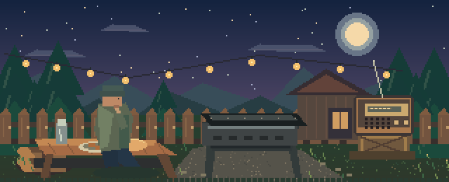

# Мангал: Тихий вечер

**Бесконечная пиксельная игра-песочница про посиделки у мангала.**

Вечер, гирлянда над двором, шипящие угли, старый приёмник и ничего срочного.
Приготовь шашлык, переверни шампуры, налей чай, посиди и послушай радио.



## Что уже работает

- **7 продуктов:** свинина, говядина, курица, рыба, колбаски, грибы и овощи.
- **Приготовление на две стороны:** положить продукт, перевернуть и вовремя снять. Можно оставить сыроватым или пережарить.
- **Мангал:** расход углей, добавление топлива, раздувание жара, анимированные языки пламени и дым.
- **Отдых:** чай из термоса, возможность закурить сигарету, анимация дыма.
- **Радио:** диапазон 87.5–108.0 МГц, настройка ползунком, помехи между станциями, регулировка громкости, включение/выключение.
- **4 станции с разными ОРИГИНАЛЬНЫМИ офлайн-мелодиями:**
  - 88.4 МГц — **Лесное FM**: уютные переборы.
  - 93.7 МГц — **Дворовая волна**: мелодии в духе ретро.
  - 100.2 МГц — **Полночь**: ночной эмбиент.
  - 106.8 МГц — **Искра**: электронные ритмы.
- **Обстановка:** пиксельная сцена, гирлянда, лес, огонь, светлячки, суточный цикл, фоновый ночной ветер. Громкость фонового эмбиента можно менять отдельно.
- **Без концовки и штрафных уровней:** игра сколько хочешь; сохраняются количество порций, уют, чай и настройки радио.
- **Управление мышью / касанием** и горячие клавиши.

> Станции — вымышленные. Это не интернет-радио; все композиции созданы специально для проекта и воспроизводятся без подключения к сети.

## Как запустить

1. Установи **Godot 4.3 или новее** (рекомендуется Godot 4.5+).
2. Распакуй архив в удобную папку.
3. В менеджере проектов Godot нажми **Import** и укажи `project.godot`.
4. После импорта нажми **F6** или **F5** для запуска главной сцены / проекта.

Для Windows и Linux игра запускается через редактор или после обычного экспорта. Для Android установи Android SDK, настрой его в Godot и создай экспортный профиль Android в меню **Project → Export**. Экран рассчитан на касания; исходный проект не содержит готового APK.

## Управление

| Действие | Управление |
|---|---|
| Мангал | вкладка **МАНГАЛ** / `G`, клик по мангалу |
| Положить продукт | выбрать продукт → **НА МАНГАЛ** |
| Перевернуть | кнопка **ПЕРЕВЕРНУТЬ** / `Пробел` / клик по мангалу |
| Снять | кнопка **СНЯТЬ** |
| Добавить угли / раздуть | кнопки на вкладке **МАНГАЛ** |
| Радио | вкладка **РАДИО** / `R` / клик по приёмнику |
| Поймать станцию | выбрать частоту ползунком или нажать кнопку-пресет |
| Проверка радио | кнопка **ТЕСТ** во вкладке **РАДИО** (включает 93.7 МГц и громкость ≥ 75%) |
| Фоновая атмосфера | ползунок **ФОН** на вкладке **ОТДЫХ** |
| Отдых | вкладка **ОТДЫХ** / `T` / клик по персонажу |
| Сигарета / чай | кнопки во вкладке **ОТДЫХ** |

### Как жарить

Обе стороны мяса должны прожариться примерно до **82% или больше**. При **190%** любая сторона считается подгоревшей. Время приготовления зависит от продукта; оно зависит также от количества углей и раздувания огня. Подсыпать угли можно сколько угодно раз.

## Структура проекта (модульная версия)

```text
mangal_evening/
├── project.godot
├── scenes/main.tscn             сцена-композиция
├── scripts/
│   ├── game.gd                 связывает подсистемы, обрабатывает ввод
│   ├── game_state.gd           приготовление еды, отдых, сохранение
│   ├── radio.gd                радиотюнер, музыка, помехи, восстановление
│   ├── soundscape.gd           фоновые звуки, эффекты
│   ├── hud.gd                  интерфейс и панели
│   ├── world.gd                визуальные эффекты сцены
│   └── data.gd                 продукты и радиостанции
├── assets/backyard.png         авторский пиксельный дворик
├── audio/*.wav                 оригинальное радио и звуки
└── tests/smoke_test.gd         регрессионный headless-тест
```

Воспроизведение не требует Python или NumPy/Pillow: аудио и пиксель-арт уже включены. В `tools/` лежат скрипты для их пересоздания.

### Изменения звука

- В старой версии фон был зажат на `−27 dB`; теперь громкость **ФОН** регулируется, значение по умолчанию около `−10 dB`.
- Радиотреки теперь работают через отдельный `radio.gd`. Устанавливаются явные точки зацикливания WAV; если воспроизведение остановится после паузы или смены аудиодрайвера, плеер перезапустится.
- Радио и фон не зависят друг от друга. Кнопка **ТЕСТ** принудительно включает станцию 93.7 МГц и выставляет громкость минимум на 75%, даже если старые настройки сохранили выключенное радио или ноль.
- Если музыки не слышно, проверь системную мультимедиа-громкость устройства и регулятор **ГРОМКОСТЬ** в игре. Частоты вне станций воспроизводят только помехи.

## Публикация в GitHub

Создание нового репозитория требует авторизованной команды GitHub. После установки [GitHub CLI](https://cli.github.com/) и выполнения `gh auth login` из папки проекта:

```bash
bash publish_to_github.sh
```

Скрипт создаёт **публичный** `mangal-tihiy-vecher` на текущем GitHub-аккаунте, делает первый коммит и отправляет файлы. Если название занято, измени его в скрипте. Для приватного репозитория замени `--public` на `--private`.

Если публикуешь проект в корне репозитория, перенеси `.github/workflows/godot-check.yml` в корень репозитория. Если он лежит внутри папки `mangal_evening/`, workflow должен быть настроен на эту вложенную папку.

## Открытое расширение

Можно добавить инвентарь, разную степень прожарки, другие мясные продукты, дождь, смену погоды, настоящую FM-шкалу в виде крутилки, персонажей-гостей и дополнительные радиостанции. Все продукты и частоты находятся в `scripts/data.gd`. Радиологику можно расширять отдельно от интерфейса.

## Проверка

Файлы проекта и WAV проверены структурными тестами; **прогон Godot в этой среде недоступен**, поэтому запуск редактором и полноценное тестирование игры здесь не подтверждены. Если Godot покажет ошибку импорта, приложите её текст — можно исправить напрямую.

## Лицензия

Код, сгенерированная графика и синтезированные композиции в этом репозитории могут свободно использоваться, изменяться и распространяться на условиях [MIT](LICENSE).


## Радиоприёмник: версия 0.3
- Настраивай **87.5–108.0 МГц** ручкой (перетаскивание пальцем/мышью), колесом мыши или ползунком; быстро переходи к четырём станциям пресетами.
- Сигнал ловится постепенно. При неточной настройке слышен шум, при точной — музыка.
- Радиозаписи воспроизводятся офлайн и проходят через фильтры 170–3200 Гц, имитируя старый громкоговоритель.
- **Заставки** генерируются прямо в Godot: короткие уникальные мелодии для каждой волны.
- В эфире периодически появляются **реплики ведущих и игровые прогнозы погоды**. Кнопка **«СЛУШАТЬ ЭФИР»** позволяет включить ближайшую передачу вручную.
- Если на устройстве установлен **русский системный TTS-голос**, реплики озвучиваются. На Android это зависит от приложения синтеза речи и установленных языков. Если русской озвучки нет, реплика видна текстом, а заставки, помехи и музыка продолжают работать.
- **Важно:** системный TTS пока не проходит через Godot-аудиошину, поэтому эффект старого динамика применяется к музыке, заставкам и помехам, но не к синтезированной речи. Это не потоковое интернет-радио, все станции вымышленные.


## Быт и пиксельный интерфейс — v0.4

### Предметы на столе
Кружка, чайник, пачка сигарет, пепельница, тарелка и баночки соуса нарисованы прямо в сцене и реагируют на касания.

Чай: сначала «Заварить» (12 секунд), потом «Налить», наконец «Выпить». Чайник даёт три порции.

Сигареты: в пачке 12 штук. Можно закурить, потушить сигарету и очистить пепельницу. Окурки накапливаются.

Тарелки и соусы: приготовленная еда поступает в запас готовых порций. Положи порцию на чистую тарелку, добавь аджику, кетчуп или горчицу, затем съешь.

### Интерфейс
Вместо прежних перегруженных панелей — 4 вкладки: «Мангал [G]», «Радио [R]», «Чай/табак [T]», «Стол [P]». Элементы управления размещены в пределах экрана 640×360. Для заголовков, кнопок и подсказок создан оригинальный процедурный пиксельный шрифт с кириллицей, без внешних TTF. Стандартные HSlider заменены на PixelSlider с мышью, колесом, клавиатурой и сенсорными жестами. Кнопки получили прямые углы.

Smoke-тест проверяет таблицу шрифтовых глифов, пересечения/выход интерактивных элементов за экран, приготовление чая, сигареты, пепельницу, подачу блюда и применение соусов.


## Independent pixel-art scene objects
All art objects are separate, editable Godot Sprite2D nodes using pixel-aligned SVG files from assets/scene_layers/. The sky, hillside, fence, garland, moon and shed live in Backdrop; grounded Garages and UtilityPole are separate. Table, Person, Grill and RadioProp are movable sprites. Cup, Kettle, Newspaper, Cigarettes, Plate, Ashtray and Sauces are individual TableProps children with hit testing based on actual sprite geometry. Cup, kettle, plate and ashtray automatically switch their texture variants when game state changes. RadioIndicator is the sole LED overlay on the standalone radio; the formerly duplicated radio painting is no longer used. Original gameplay mechanics, pixel HUD, and saved progress are preserved.


### Android render compatibility hotfix
Godot on Android can display an empty scene when runtime SVG textures cannot be imported or resolved, even if Linux CI successfully renders them. All 18 independent scene textures are now committed as PNGs (generated at native 1:1 pixel dimensions), and the scene plus dynamic table state textures explicitly load **.png**. The original editable SVG source images remain alongside the PNG files for later changes. Every time source SVG changes, regenerate the matching PNG before committing, e.g. `rsvg-convert some_sprite.svg -o some_sprite.png`. There is also a GitHub Actions rasterization workflow for SVG edits. The smoke test checks all 18 PNG paths and ensures the actual background texture references a PNG.
